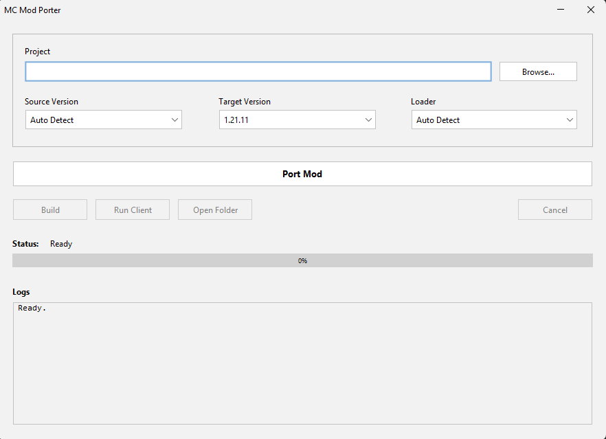

<p align="center">
  
</p>

MC Mod Porter is a tool for porting Minecraft Java Edition mods across supported versions — from 1.16 through the 26.x calendar versioning format.

Supported loaders are **Fabric** and **NeoForge** where support data is available for the selected Minecraft version.


[](LICENSE)
[](https://discord.gg/vV2USr9phF)

## Download

**[Auto-Porter Beta — Releases page](https://github.com/reqsery/mc-mod-porter/releases/tag/v1.3.0-beta)**

- `auto-porter-1.3.0-beta.jar` — one cross-platform JAR for both the GUI and CLI

```bash
java -jar auto-porter-1.3.0-beta.jar
```

> Requires Java 21+. See the [Java Requirements](#java-requirements) table below.

---

## Video Tutorial

Watch the showcase and porting walkthrough: [Auto-Porter demo on YouTube](https://www.youtube.com/watch?v=bEKUnVigAlw)

---

## Quick Start (30 seconds)
> **Note:** Use the extracted mod source/project folder containing `build.gradle`, `gradle.properties`, and `src/` — not the compiled release `.jar`.

### Option A — Use the GUI (recommended)

Open the JAR without arguments, choose the mod project folder, confirm the detected source version and loader, select a target version, and click **Port Mod**.

```bash
java -jar auto-porter-1.3.0-beta.jar
```

The same window can rebuild the ported project, run its Gradle client task where supported, open the output folder, and show live porter/build logs.

The bottom quick links open bug reports, feature requests, Discord, GitHub, and contributor guidance in your default browser.

#### GUI preview

<p align="center">
  
</p>

The preview above was taken with v1.2.0-beta; v1.3.0-beta also includes the bottom quick links.

### Option B — Use the CLI

Launching the same JAR with CLI arguments keeps the existing command-line behavior. Use `--help` to see every command.

```bash
# Show CLI help
java -jar auto-porter-1.3.0-beta.jar --help

# 1. Download from releases page
java -jar auto-porter-1.3.0-beta.jar --list-versions

# 2. Dry run (see what would change, no files touched)
java -jar auto-porter-1.3.0-beta.jar C:/path/to/mymod 1.20.4 1.20.5 --dry-run

# 3. Port your mod
java -jar auto-porter-1.3.0-beta.jar C:/path/to/mymod 1.20.4 1.20.5
```

The ported mod is created at `C:/path/to/mymod-ported-1_20_5`. Your original is never touched.

### Option C — Build from source

```bash
git clone https://github.com/reqsery/mc-mod-porter.git
cd mc-mod-porter/auto-porter
./gradlew build
java -jar build/libs/auto-porter-1.3.0-beta.jar --help
```

**Windows?** Use `gradlew.bat build`

---

## What It Does

The auto-porter handles the **mechanical, repetitive part** of version porting:

1. ✅ Updates `build.gradle` plugin versions
2. ✅ Updates `gradle.properties` dependency versions
3. ✅ Applies Java source/API migration patches
4. ✅ Updates Fabric/NeoForge mod metadata
5. ✅ Runs build verification and reports remaining errors
6. ✅ Uses the verified migration knowledge base for supported version hops

**What it doesn't do:** Logic changes. If your code uses APIs that were completely redesigned, you'll need to manually fix those (the tool tells you where).

---

## Getting Help

### The Tool Crashes or Gives an Error?

Check [**docs/TROUBLESHOOTING.md**](docs/TROUBLESHOOTING.md) for solutions to common build errors.

### Want to Understand a Specific Version Change?

Look in [**knowledge-base/minecraft/**](knowledge-base/minecraft/) for that version hop. Example: `1.19_to_1.20.md` contains all API changes between those versions.

### Questions or Ideas?

- **Discord:** [https://discord.gg/vV2USr9phF](https://discord.gg/vV2USr9phF)
- **Discussions:** [Start or join one here](../../discussions)
- **FAQ:** [docs/FAQ.md](docs/FAQ.md)

---

## Supported Versions

**1.x format:** `1.16` – `1.16.5` · `1.17.1` · `1.18` – `1.18.2` · `1.19` – `1.19.4` · `1.20` – `1.20.6` · `1.21` – `1.21.11`

**26.x format** (calendar versioning, from 2026): `26.1` · `26.1.1` · `26.1.2` · `26.2` · `26.3`

See [docs/FAQ.md](docs/FAQ.md) for why the version format changed at 26.1.

---

## Java Requirements

MC Mod Porter itself requires **Java 21 or newer**. Building the generated project may require a different Java version based on its target Minecraft version:

| Minecraft Versions  | Java Required |
|---------------------|---------------|
| 1.16 – 1.17.x       | Java 16       |
| 1.18 – 1.20.4       | Java 17       |
| 1.20.5 – 1.21.11    | Java 21       |
| 26.1+               | Java 25 (LTS) |

---

## How It Works

1. **Check** `knowledge-base/minecraft/` for breaking API changes between versions
2. **Look up** `patterns/` for quick cross-version rename tables
3. **Find** `knowledge-base/loaders/` for correct dependency versions
4. **Verify** `java/` for Java toolchain requirements
5. **Run** `auto-porter` to automatically apply known patterns

---

## Folder Structure

```
auto-porter/        — GUI + CLI tool: ports a mod folder to a target MC version
scripts/            — Utility scripts (wrappers, validators)

knowledge-base/
  minecraft/        — one file per adjacent version hop
    1.16_to_1.17.md
    1.19.4_to_1.20.md      — all API changes documented here
    ...
  loaders/
    fabric/versions.md     — Fabric Loader + API version table
    neoforge/versions.md   — NeoForge version table

patterns/
  method-renames.md  — Verified method rename table
  class-moves.md     — Verified class move/rename table
  signatures.md      — Code change examples

docs/
  CONTRIBUTING.md    — How to add version data
  TROUBLESHOOTING.md — Common build errors & fixes
  FAQ.md             — Common questions
```

---

## Want to Contribute?

**Yes, please!** See [.github/CONTRIBUTING.md](.github/CONTRIBUTING.md) for:
- How to set up locally
- How to submit code changes
- How to add migration data
- How to report bugs or suggest features

### Quick paths:
- 🐛 **Found a bug?** → [Open a bug report](../../issues/new?template=bug_report.md)
- 💡 **Have an idea?** → [Suggest a feature](../../issues/new?template=feature_request.md)
- 🔧 **Want to code?** → [Read the contributor guide](.github/CONTRIBUTING.md)
- 📚 **Want to improve docs?** → Fork & submit a PR

---

## Documentation

| File | What it covers |
|------|----------------|
| [.github/CONTRIBUTING.md](.github/CONTRIBUTING.md) | How to contribute code or data |
| [docs/CONTRIBUTING.md](docs/CONTRIBUTING.md) | Rules for adding version migration data |
| [docs/TROUBLESHOOTING.md](docs/TROUBLESHOOTING.md) | Common build errors and how to fix them |
| [docs/FAQ.md](docs/FAQ.md) | Common questions about versioning and loaders |
| [AI_GUIDE.md](AI_GUIDE.md) | How to use this repo with any AI assistant |

---

## The Golden Rule

> **The knowledge-base is the single source of truth.**
>
> Every API change in `auto-porter` is backed by a verified source (Mojang, Fabric, NeoForge official docs).
> No guessing. No hallucinations.

See [docs/CONTRIBUTING.md](docs/CONTRIBUTING.md) for the full accuracy policy.

---

## License

This project is licensed under **MIT + Commons Clause**. See [LICENSE](LICENSE) for details.

---

**Made with ❤️ for the Minecraft modding community.**

Have feedback? Join us on [Discord](https://discord.gg/vV2USr9phF)!
