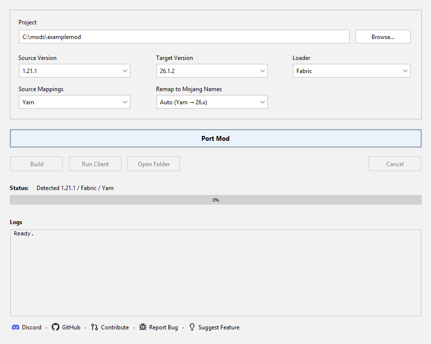

<p align="center">
  
</p>

MC Mod Porter is a tool for porting Minecraft Java Edition mods across supported versions — from 1.16 through the 26.x calendar versioning format.

Supported loaders are **Fabric** and **NeoForge** where support data is available for the selected Minecraft version.


[](LICENSE)
[](https://discord.gg/vV2USr9phF)

## Download

**[Auto-Porter Beta — Releases page](https://github.com/reqsery/mc-mod-porter/releases/tag/v1.4.0-beta)**

- `auto-porter-1.4.0-beta.jar` — one cross-platform JAR for both the GUI and CLI (needs Java 21+)
- **Windows:** `MC-Mod-Porter-1.4.0-beta-windows.zip` — `MC-Mod-Porter.exe` with its own Java runtime (no Java
  install needed). Unzip it and run `MC-Mod-Porter.exe`, or run `install-windows.ps1` from the zip for Start Menu
  and Desktop shortcuts (see [Windows app](#windows-app-mc-mod-porterexe))

```bash
java -jar auto-porter-1.4.0-beta.jar
```

> The JAR requires Java 21+. Building the ported mod may need a different JDK — see [Java Requirements](#java-requirements).

---

## Video Tutorial

Watch the showcase and porting walkthrough: [Auto-Porter demo on YouTube](https://www.youtube.com/watch?v=bEKUnVigAlw)

---

## Quick Start (30 seconds)
> **Note:** Use the extracted mod source/project folder containing `build.gradle`, `gradle.properties`, and `src/` — not the compiled release `.jar`.

### Option A — Use the GUI (recommended)

Open the JAR (or `MC-Mod-Porter.exe`) without arguments, choose the mod project folder, confirm the detected source version, loader and **source mappings** (Yarn or Mojang), select a target version, and click **Port Mod**. **Remap to Mojang Names** controls whether Yarn sources are converted (Auto does it when porting to 26.x, which has no Yarn).

```bash
java -jar auto-porter-1.4.0-beta.jar
```

The same window shows live progress and logs, and can rebuild the ported project, run its Gradle client task where supported, and open the output folder.

The bottom quick links open bug reports, feature requests, Discord, GitHub, and contributor guidance in your default browser.

#### GUI preview

<p align="center">
  
</p>

### Option B — Use the CLI

Launching the same JAR with CLI arguments keeps the existing command-line behavior. Use `--help` to see every command.

```bash
# Show CLI help
java -jar auto-porter-1.4.0-beta.jar --help

# 1. Download from releases page
java -jar auto-porter-1.4.0-beta.jar --list-versions

# 2. Dry run (see what would change, no files touched)
java -jar auto-porter-1.4.0-beta.jar C:/path/to/mymod 1.20.4 1.20.5 --dry-run

# 3. Port your mod
java -jar auto-porter-1.4.0-beta.jar C:/path/to/mymod 1.20.4 1.20.5

# Yarn (Fabric) sources going to 26.x are remapped to Mojang names automatically
java -jar auto-porter-1.4.0-beta.jar C:/path/to/mymod 1.21.1 26.1.2

# Switch a Yarn mod to Mojang names without changing version gaps
java -jar auto-porter-1.4.0-beta.jar C:/path/to/mymod 1.20.1 1.21.1 --remap
```

| Option | Meaning |
|---|---|
| `--dry-run` | Preview the changes on the original folder; nothing is written |
| `--no-build` | Skip the `gradlew compileJava` check |
| `--remap` | Remap Yarn names in the sources to Mojang names |
| `--no-remap` | Never remap (by default Yarn sources are remapped when porting to 26.x) |
| `--source-mappings auto\|yarn\|mojang` | Which names the sources use (default: detected from the build files) |

The ported mod is created at `C:/path/to/mymod-ported-1_20_5`. Your original is never touched.

### Option C — Build from source

```bash
git clone https://github.com/reqsery/mc-mod-porter.git
cd mc-mod-porter/auto-porter
./gradlew build
java -jar build/libs/auto-porter-1.4.0-beta.jar --help
```

**Windows?** Use `gradlew.bat build`

### Windows app (`MC-Mod-Porter.exe`)

```powershell
cd mc-mod-porteruto-porter
.\gradlew.bat packageWindowsApp
powershell -ExecutionPolicy Bypass -File packaging\windows\install-windows.ps1
```

`packageWindowsApp` builds `auto-porter/build/jpackage/MC-Mod-Porter/` with `MC-Mod-Porter.exe` (GUI),
`MC-Mod-Porter-CLI.exe` (command line) and a bundled Java runtime. The install script copies it to
`%LOCALAPPDATA%\Programs\MC-Mod-Porter` and adds **MC Mod Porter** to the Start Menu (Windows search) and the
Desktop. `packageWindowsZip` makes a release zip; `packageWindowsInstaller` makes a setup `.exe` if the
[WiX Toolset](https://wixtoolset.org/) is installed.

---

## What It Does

The auto-porter handles the **mechanical, repetitive part** of version porting:

1. ✅ Updates `build.gradle` / `build.gradle.kts` — hard-coded and property-driven versions alike: Loom and ModDevGradle plugins, `neoForge { version }`, Fabric Loader/API, Minecraft, Java toolchain, and the 26.x Loom changes (`net.fabricmc.fabric-loom`, no mappings, `mod*` → plain configurations, `remapJar` → `jar`)
2. ✅ Updates `gradle.properties` (`minecraft_version`, `neo_version`, `moddev_version`, `loader_version`, `fabric_version`, `loom_version`, ranges, …)
3. ✅ Updates the Gradle wrapper to the version the official Fabric example mod / NeoForge MDK use
4. ✅ Remaps Yarn sources to Mojang names (downloads the official mappings once)
5. ✅ Applies Java source/API migration rules for every version hop crossed
6. ✅ Updates `fabric.mod.json`, `mods.toml` / `neoforge.mods.toml` and mixin `compatibilityLevel`
7. ✅ Checks that no stale version numbers remain, then verifies the build with Gradle

**What it doesn't do:** Logic changes. If your code uses APIs that were completely redesigned, you'll need to manually fix those (the tool tells you where).

---

## Getting Help

### The Tool Crashes or Gives an Error?

Check [**docs/TROUBLESHOOTING.md**](docs/TROUBLESHOOTING.md) for solutions to common build errors.

### Want to Understand a Specific Version Change?

Look in [**knowledge-base/minecraft/**](knowledge-base/minecraft/) for that version hop. Example: `1.19_to_1.20.md` contains all API changes between those versions.

### Questions or Ideas?

- **Discord:** [https://discord.gg/vV2USr9phF](https://discord.gg/vV2USr9phF)
- **Discussions:** [Start or join one here](../../discussions)
- **FAQ:** [docs/FAQ.md](docs/FAQ.md)

---

## Supported Versions

**1.x format:** `1.16` – `1.16.5` · `1.17.1` · `1.18` – `1.18.2` · `1.19` – `1.19.4` · `1.20` – `1.20.6` · `1.21` – `1.21.11`

**26.x format** (calendar versioning, from 2026): `26.1` · `26.1.1` · `26.1.2` · `26.2` · `26.3`

See [docs/FAQ.md](docs/FAQ.md) for why the version format changed at 26.1.

---

## Java Requirements

MC Mod Porter itself requires **Java 21 or newer**. Building the generated project may require a different Java version based on its target Minecraft version:

| Minecraft Versions  | Java Required |
|---------------------|---------------|
| 1.16 – 1.16.5       | Java 8        |
| 1.17.1              | Java 16       |
| 1.18 – 1.20.4       | Java 17       |
| 1.20.5 – 1.21.11    | Java 21       |
| 26.1+               | Java 25 (LTS) |

The porter sets the ported project's Java toolchain, `JavaVersion`/`options.release` and mixin `compatibilityLevel`
to this version. Gradle itself runs on whatever JDK you start it with (Gradle 9 needs Java 17+ to run), and the
toolchain compiles for the version above.

---

## How It Works

1. **Check** `knowledge-base/minecraft/` for breaking API changes between versions
2. **Look up** `patterns/` for quick cross-version rename tables
3. **Find** `knowledge-base/loaders/` for correct dependency versions
4. **Verify** `java/` for Java toolchain requirements
5. **Run** `auto-porter` to automatically apply known patterns

---

## Folder Structure

```
auto-porter/        — GUI + CLI tool: ports a mod folder to a target MC version
  packaging/windows/ — jpackage launcher config, app icon, install/uninstall scripts
scripts/            — Utility scripts (wrappers, validators)

knowledge-base/
  minecraft/        — one file per adjacent version hop
    1.16_to_1.17.md
    1.19.4_to_1.20.md      — all API changes documented here
    ...
  loaders/
    fabric/versions.md     — Fabric Loader + API version table
    neoforge/versions.md   — NeoForge version table

patterns/
  method-renames.md  — Verified method rename table
  class-moves.md     — Verified class move/rename table
  signatures.md      — Code change examples

docs/
  CONTRIBUTING.md    — How to add version data
  TROUBLESHOOTING.md — Common build errors & fixes
  FAQ.md             — Common questions
```

---

## Want to Contribute?

**Yes, please!** See [.github/CONTRIBUTING.md](.github/CONTRIBUTING.md) for:
- How to set up locally
- How to submit code changes
- How to add migration data
- How to report bugs or suggest features

### Quick paths:
- 🐛 **Found a bug?** → [Open a bug report](../../issues/new?template=bug_report.md)
- 💡 **Have an idea?** → [Suggest a feature](../../issues/new?template=feature_request.md)
- 🔧 **Want to code?** → [Read the contributor guide](.github/CONTRIBUTING.md)
- 📚 **Want to improve docs?** → Fork & submit a PR

---

## Documentation

| File | What it covers |
|------|----------------|
| [.github/CONTRIBUTING.md](.github/CONTRIBUTING.md) | How to contribute code or data |
| [docs/CONTRIBUTING.md](docs/CONTRIBUTING.md) | Rules for adding version migration data |
| [docs/TROUBLESHOOTING.md](docs/TROUBLESHOOTING.md) | Common build errors and how to fix them |
| [docs/FAQ.md](docs/FAQ.md) | Common questions about versioning and loaders |

---

## The Golden Rule

> **The knowledge-base is the single source of truth.**
>
> Every API change in `auto-porter` is backed by a verified source (Mojang, Fabric, NeoForge official docs).
> No guessing. No hallucinations.

See [docs/CONTRIBUTING.md](docs/CONTRIBUTING.md) for the full accuracy policy.

---

## License

This project is licensed under **MIT + Commons Clause**. See [LICENSE](LICENSE) for details.

---

**Made with ❤️ for the Minecraft modding community.**

Have feedback? Join us on [Discord](https://discord.gg/vV2USr9phF)!
